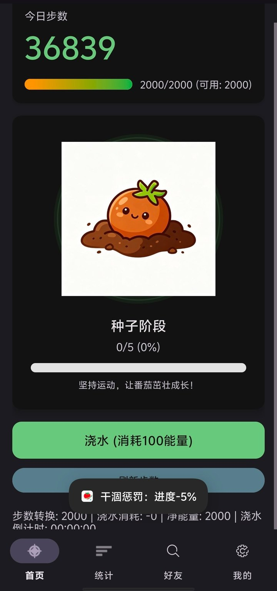
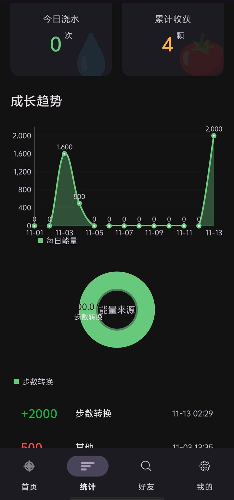
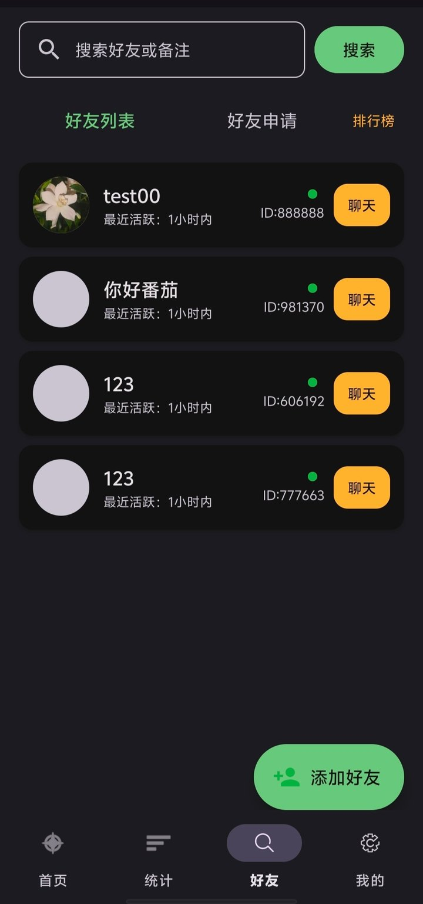
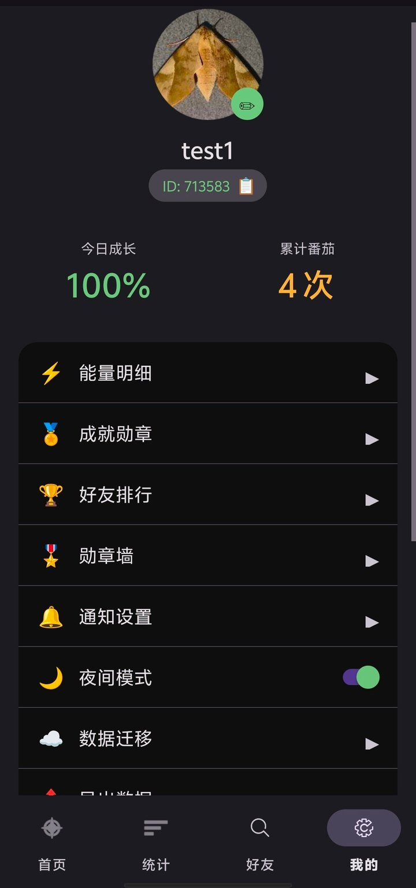

# 🍅 运动番茄 Sporty Tomato

> 把每天走的路，种成一棵会结果的番茄。

一个把「步数 → 能量 → 浇水 → 收获」串起来的 Android 运动激励应用：走路攒能量，能量浇灌虚拟番茄，番茄成熟后收获、送好友、上排行榜。核心是把「坚持运动」这件反人性的事，变成每天有反馈的养成游戏。

<p align="center">
  
</p>

- **客户端**：Android 原生（Java + Kotlin），Room + Health Connect + WorkManager
- **后端**：阿里云 EMAS Serverless 云函数（Node.js），MongoDB 风格数据集合
- **官网**：React + Vite + TypeScript + Tailwind 的下载落地页
- **版本**：v2.0（versionCode 2）｜**包名**：`com.sportytomato.app`｜**最低支持**：Android 9（API 28）

---

## 📱 界面预览

<table>
  <tr>
    <td align="center"><br /><sub><b>首页</b> · 步数转能量，浇水养番茄</sub></td>
    <td align="center"><br /><sub><b>统计</b> · 成长趋势与能量来源</sub></td>
  </tr>
  <tr>
    <td align="center"><br /><sub><b>好友</b> · 列表 / 申请 / 排行榜</sub></td>
    <td align="center"><br /><sub><b>我的</b> · 勋章、排行、数据迁移</sub></td>
  </tr>
</table>

> 截图来自真机（深色模式），页面数据为测试账号。

---

## ✨ 功能特性

### 🚶 运动与能量
- 通过 **Health Connect** 读取每日步数（`READ_STEPS` / `ACTIVITY_RECOGNITION` 权限），并保留传感器兜底
- 步数按 **10 步 = 1 点能量** 折算，每日能量上限 **2000 点**
- 超出上限的能量按 **50% 结转到次日**（次日结转上限 500 点），不浪费当天步数
- 每日零点自动重置步数与能量（WorkManager `DailyResetWorker`）

### 🍅 番茄养成
- 番茄四阶段可视化：种子 → 小苗 → 开花 → 成熟
- 每次浇水消耗 100 点能量、进度 +20%
- **干涸惩罚**：连续 24 小时未浇水且未成熟，进度 -5%，浇水后倒计时重置
- 成熟后可收获，随机触发「捐赠」彩蛋；收获次数累计进成就

### 👥 社交
- 好友搜索、申请、同意/拒绝、删除（系统分配短 ID）
- 好友 1v1 私聊，消息本地持久化
- 周收获排行榜，支持下拉刷新
- 分享卡片（Canvas 绘制）与好友邀请

### 🏅 成就与数据
- 勋章墙，7 枚徽章：初次收获 / 收获达人 / 收获大师 / 园丁 / 万步达人 / 能量大师 / 好友达人
- 统计看板：步数、能量、收获趋势（MPAndroidChart 饼图 + 折线图）
- 数据导出为 CSV

### 🔐 账号与同步
- 微信登录（OAuth2.0）与访客模式双入口
- 昵称修改 + 敏感词过滤
- 本地 Room 与云端 EMAS 双数据源：线程池异步同步、断网重试、冲突合并（`MergeLog` 留痕）

---

## 🧱 技术栈

| 层 | 技术 |
|---|---|
| 客户端 | Java / Kotlin、Android SDK 35、ViewBinding、Material 1.12、深色模式 |
| 本地存储 | Room 2.5.2（12 个实体、11 个 DAO） |
| 网络 | OkHttp 4.12、EMAS 云函数 HTTP 触发 |
| 后台任务 | WorkManager 2.10（每日重置、干涸惩罚、同步队列） |
| 健康数据 | Health Connect Client 1.1 |
| 图表 | MPAndroidChart v3.1.0 |
| 后端 | Node.js 云函数（EMAS Serverless）：`sporty-api` 通用 CRUD、`authUser` 微信登录 |
| 官网 | React 18 + Vite + TypeScript + Tailwind CSS |

---

## 🏗 架构

```
┌──────────────────────────────────────────────────────────┐
│                     View 层（Activity / Fragment）        │
│  Login / Home / Friends / Stats / Profile / Rank / Badge │
└───────────────────────────┬──────────────────────────────┘
                            │
┌───────────────────────────▼──────────────────────────────┐
│                     Service 层                            │
│  StepSensor / Energy / Tomato / Harvest / Achievement    │
│  Friend / Share / Notification / SensitiveWord           │
│  CloudSync / ConflictMerge                                │
└───────────────────────────┬──────────────────────────────┘
                            │
┌───────────────────────────▼──────────────────────────────┐
│                  Repository 层（双实现）                   │
│  UserRepository   ─┬─ UserRepositoryImpl   （Room 本地）  │
│                    └─ EMASUserRepository   （云端集合）   │
│  Tomato / Energy / Harvest / Friend / Stats / Message    │
└───────────────┬──────────────────────────┬───────────────┘
                │                          │
      ┌─────────▼─────────┐      ┌─────────▼─────────────┐
      │   Room 本地数据库   │      │  EMAS Serverless      │
      │   12 实体 / 11 DAO  │      │  sporty-api（CRUD）    │
      │                    │      │  authUser（微信登录）   │
      └────────────────────┘      └───────────────────────┘
```

---

## 📁 目录结构

```
sporty-tomato/
├─ app/                                  # Android 客户端
│  └─ src/main/java/com/sportytomato/app/
│     ├─ model/                          # 实体、DAO、数据库
│     │  ├─ entity/                      # User / TomatoState / EnergyRecord ...
│     │  ├─ dao/                         # UserDao / TomatoDao / SyncQueueDao ...
│     │  └─ database/                    # AppDatabase
│     ├─ repository/                     # 数据仓库抽象 + 双实现
│     │  ├─ emas/                        # 云端实现（EMAS 集合）
│     │  └─ mock/                        # 离线 Mock 实现
│     ├─ service/                        # 业务服务（步数、能量、番茄、同步…）
│     ├─ view/                           # 页面、Adapter、Worker
│     └─ util/                           # 工具类
├─ emas-cloud-functions/
│  ├─ sporty-api/                        # 通用数据 CRUD 云函数
│  └─ authUser/                          # 微信 OAuth 登录云函数
├─ website/                              # React + Vite 官网（下载页）
├─ docs/screenshots/                     # README 应用截图
├─ gradle/                               # Gradle Wrapper
├─ build.gradle.kts
├─ settings.gradle.kts
├─ sporty-tomato.png                     # Logo
└─ README.md
```

---

## 🚀 快速开始

### 1. 环境要求

| 依赖 | 版本 |
|---|---|
| Android Studio | Hedgehog (2023.1.1) 及以上 |
| JDK | 17 |
| Android SDK | compileSdk 35 / minSdk 28 |
| Gradle | 9.3.1（项目内置 Wrapper，无需手动装） |

### 2. 运行 Android 客户端

```bash
# 克隆
git clone https://github.com/guanhaitingtaozys/sporty-tomato.git
cd sporty-tomato

# 构建 Debug APK
./gradlew assembleDebug          # Windows: gradlew.bat assembleDebug
```

APK 输出：`app/build/outputs/apk/debug/app-debug.apk`

也可以直接用 Android Studio 打开根目录，等 Gradle 同步完成后点 Run。首次同步需下载依赖，约 5–10 分钟。

> 仓库内已附带一份构建好的 Debug APK：`app/build/intermediates/apk/debug/app-debug.apk`，可装到 Android 9 以上手机直接体验。
> 想体验完整云端功能（微信登录 / 好友 / 排行榜），需要按下一步部署云函数；不部署时可用 Mock 数据源跑通本地养成流程。

### 3. 部署云函数（可选）

云函数运行在 **阿里云 EMAS Serverless**：

1. 在 EMAS 控制台创建服务空间，获取 AppID / AppSecret / 服务空间 ID
2. 创建两个云函数：`sporty-api`、`authUser`，分别上传对应目录的 `index.js`
3. 为 `sporty-api` 配置 HTTP 触发器（GET / POST 均可）
4. 在 `authUser` 中填入自己的微信开放平台 AppID 与 Secret（当前代码从环境变量 `WECHAT_APP_SECRET` 读取，未配置时使用占位值）
5. 客户端把服务地址填到 `EMASConfig.java` 后重新打包

**`sporty-api` 支持的动作**（请求参数：`action`、`collection`、`data`、`query`、`options`）：

| action | 说明 |
|---|---|
| `ping` | 连通性测试 |
| `find` / `findOne` | 条件查询 |
| `insertOne` / `insertMany` | 插入 |
| `updateOne` / `updateMany` | 更新 |
| `deleteOne` / `deleteMany` | 删除 |
| `count` | 计数 |

### 4. 运行官网（可选）

```bash
cd website
npm install
npm run dev
```

---

## 🗄 数据模型

Room 共 12 个实体、11 个 DAO，核心表：

| 实体 | 作用 |
|---|---|
| `User` | 用户信息、访客标识、短 ID |
| `TomatoState` | 番茄阶段、浇水进度、干涸倒计时 |
| `StepRecord` / `EnergyRecord` | 每日步数、能量收支明细 |
| `WateringLog` / `HarvestLog` | 浇水与收获流水 |
| `Friendship` / `Message` | 好友关系、私聊消息 |
| `UserBadge` / `BadgeTemplate` | 已解锁勋章、勋章模板（7 枚） |
| `SyncQueue` / `MergeLog` | 待同步任务队列、冲突合并日志 |

---

## 🛠 开发说明

- **双数据源**：`RepositoryManager` 统一管理，可在「本地 Room」与「云端 EMAS」之间切换；`mock/` 下提供离线 Mock 实现，无网络也能演示。
- **同步机制**：`CloudSyncService` 用线程池异步推送，`SyncQueue` 记录待同步任务，断网后重试；`ConflictMergeService` 按时间戳合并冲突并写入 `MergeLog`。
- **定时任务**：`DailyResetWorker`（每日零点重置）、`DryPenaltyWorker`（干涸惩罚检查）通过 WorkManager 调度。
- **UI**：ViewBinding + Material Components，22 个布局文件，支持深色模式（`values-night`）。

---

## ⚠️ 已知限制

- 云函数依赖 EMAS 服务空间，未部署时只能走 Mock 数据源
- 微信登录需要自备微信开放平台应用与签名配置
- 仓库中提交了 `app/build` 构建产物，后续会清理并改用 GitHub Releases 分发 APK
- 暂无自动化测试与 CI

## 🗺 Roadmap

- [ ] 清理构建产物，APK 改走 Releases
- [ ] 补充单元测试（Room DAO、能量/番茄规则）
- [ ] 支持 iOS / 鸿蒙版本（远期）

---

## 👤 作者

**张云舒** ｜ 杭州师范大学 计算机科学与技术（师范）｜ 2027 届
《软件工程》课程项目（2026 春季学期）

> 本项目仅用于课程学习与技术交流，未经许可请勿用于商业用途。
